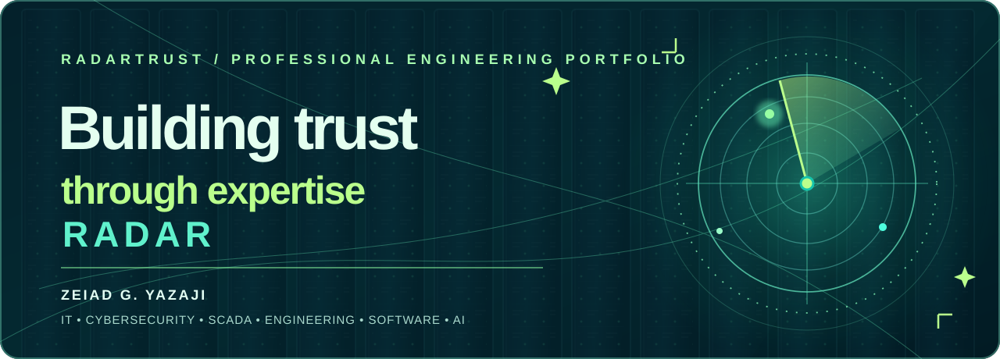
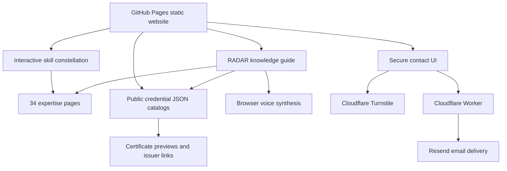

<div align="center">

[](https://radartrust.github.io/USA/)

# [RadarTrust](https://github.com/RadarTrust)

## [RadarTrust.github.io/USA](https://radartrust.github.io/USA/)

### Engineering credibility, demonstrated through technology, projects and verifiable learning.

**Zeiad G. Yazaji** — Electronics & Communications Engineering · Enterprise Technology · Cybersecurity · Automation · Software & AI

[**My Publications & Projects**](https://radartrust.github.io/USA/works.html) · [**Live website**](https://radartrust.github.io/USA/) · [**Browse credentials**](https://radartrust.github.io/USA/#credentials) · [**Ask Radar**](https://radartrust.github.io/USA/) · [**Secure contact**](https://radartrust.github.io/USA/#/c/8f2a91)

   

</div>

---

## The mission

RadarTrust is a professional engineering portfolio developed to make technical experience **discoverable, contextual and verifiable**. Instead of a list of buzzwords, the project combines real résumé-backed roles, an interactive technology constellation, 34 expertise profiles, original credential records and source-aware navigation.

**Building trust through expertise Radar** is more than a visual headline: each capability page explains what the field involves, presents related work where documented and links to appropriate certificate or course records without falsely equating course completion with professional licensing or vendor certification.

### A unified, original visual language

A dark server-room backdrop, layered teal glass panels, luminous mint highlights, responsive micro-interactions and a rotating circular radar create a consistent interface across the landing page and every expertise detail view. The website is deliberately designed for modern desktop and mobile browsers, with keyboard access and reduced-motion fallbacks.


## Meet RADAR — animated voice knowledge guide

The site includes an interactive **holographic 3D-style avatar** with lightweight CSS animation, natural-sounding voice playback *when a compatible browser voice is available*, microphone input *when supported and explicitly enabled*, and contextual replies about:

- Zeiad's professional background, roles, documented projects and sector experience.
- Skills such as SCADA, ERP, data centers, cybersecurity, AI and programming.
- Published certificates and credential links supplied in the site's own JSON catalogs.
- Relevant specialist pages and the secure contact form.

**Trust and cost boundaries:** RADAR is a **local, structured knowledge guide**, not an external generative language model. Its responses are rule-assisted and linked to published project information; it does not fabricate answers, make calls to paid AI APIs or upload chat prompts to a model provider. Speech synthesis uses the browser's available voices, which vary by device. Optional microphone recognition may rely on a browser provider and is activated only after a clear user confirmation. The knowledge guide is **not** a source of certified professional advice.

## Explore 34 expertise profiles

[AI](https://radartrust.github.io/USA/#/s/23d513) · [ERP](https://radartrust.github.io/USA/#/s/b34e25) · [MATLAB](https://radartrust.github.io/USA/#/s/83538b) · [Python](https://radartrust.github.io/USA/#/s/e3dd87) · [Data Analysis](https://radartrust.github.io/USA/#/s/b97b9a) · [SQL](https://radartrust.github.io/USA/#/s/011f26) · [Cybersecurity](https://radartrust.github.io/USA/#/s/1f0230) · [PostgreSQL](https://radartrust.github.io/USA/#/s/8694be) · [Delphi](https://radartrust.github.io/USA/#/s/17c331) · [Networking](https://radartrust.github.io/USA/#/s/991738) · [Maintenance](https://radartrust.github.io/USA/#/s/78166b) · [UI / UX](https://radartrust.github.io/USA/#/s/3178b9) · [Data Center](https://radartrust.github.io/USA/#/s/73cfc5) · [Full Stack](https://radartrust.github.io/USA/#/s/975b28) · [Oracle](https://radartrust.github.io/USA/#/s/21aa67) · [Animation](https://radartrust.github.io/USA/#/s/41e389) · [Voice Biometrics](https://radartrust.github.io/USA/#/s/7687f3) · [Investigation](https://radartrust.github.io/USA/#/s/6b4da5) · [Ethical Hacking](https://radartrust.github.io/USA/#/s/f942f0) · [Windows](https://radartrust.github.io/USA/#/s/064002) · [Linux](https://radartrust.github.io/USA/#/s/94f302) · [Firewall](https://radartrust.github.io/USA/#/s/ce907b) · [Cisco](https://radartrust.github.io/USA/#/s/1dc1fa) · [NETGEAR](https://radartrust.github.io/USA/#/s/1565a4) · [Servers](https://radartrust.github.io/USA/#/s/cd0cf1) · [Routers](https://radartrust.github.io/USA/#/s/76b38b) · [Switches](https://radartrust.github.io/USA/#/s/d9cb2f) · [Scripting](https://radartrust.github.io/USA/#/s/74b727) · [Control Panels](https://radartrust.github.io/USA/#/s/64cf99) · [VoIP](https://radartrust.github.io/USA/#/s/f531b5) · [Project](https://radartrust.github.io/USA/#/s/7b5fea) · [N+](https://radartrust.github.io/USA/#/s/9de71c) · [A+](https://radartrust.github.io/USA/#/s/85d5ad) · [SI](https://radartrust.github.io/USA/#/s/600291)

Each page has its own non-descriptive hash route `/#/s/<six-character-id>`, accessible through the animated skill constellation. A hash is a **routing identifier, not encryption or an access-control measure**.

## Selected résumé-backed professional experience

| Organization / engagement | Documented professional scope |
| --- | --- |
| **United Electric System, Pennsylvania** | ERP workflow support, bill-of-material records, PPL-related electrical control panels, SCADA, testing, troubleshooting and commissioning |
| **New Generation Group Offshore** | Technology and cybersecurity leadership, ERP systems, databases, server/UPS and data-center deployment oversight |
| **Samsung HVA** | Multi-branch IT operations, Cosmos / Transtek ERP workflows, programming, deployment documentation and user training |
| **Khayyat Group / Infinite Technology** | Industrial automation and SCADA-related technical project delivery, including Siemens S7-400 contexts |
| **Alyeser / Kabour** | Surveillance, CCTV/NVR/VMS systems and enterprise infrastructure management |
| **Olivetti and independent consulting** | Banking systems programming and maintenance; software, AI workflow and technology training |

These are concise descriptions grounded in the professional résumé, not invented client testimonials, contract values or performance statistics.

## Credentials and proof

The public portfolio features a curated set of credential records, original certificate previews and direct issuer links where available. Entries are labeled by their actual evidence type, including **issuer-issued digital credential**, **professional certification** and **course or specialization completion**.

Examples include the IBM-issued SkillsBuild Cybersecurity record, EC-Council Certified Security Analyst (ECSA), Microsoft Full-Stack Developer and Python Development learning programs, IBM AI Developer, and Google Cybersecurity/Data Analytics learning records. Issuers alone determine the status, validity and expiration of their credentials.

[**Explore the credential evidence →**](https://radartrust.github.io/USA/#credentials)

## Architecture



The contact-service credentials are stored as encrypted Worker configuration values, **not committed to the repository**. The code here is a static website; browser-visible code and public files should never contain secrets. The contact delivery and abuse-prevention features depend on independently deployed external infrastructure, subject to the providers' free-tier limits.

## Actual implementation languages

| Language / format | Used for |
| --- | --- |
| **HTML5** | Main landing page, contact form, 34 skill detail documents |
| **CSS3** | Responsive server-room visual language, radar animation, holographic avatar and UI effects |
| **JavaScript** | Client navigation, credential directory, interactive skill nodes and RADAR knowledge guide |
| **Python 3** | Source-free, standard-library audit script in `tools/site_audit.py` |
| **JSON** | Credential catalogs used by site and knowledge assistant |
| **SVG** | Original illustrated branding and scalable visual assets |

**Other professional languages and platforms** in the résumé include Python, C#, VB.NET, SQL Server, Oracle, SCADA and automation systems. They are not falsely inserted into the repository solely to influence GitHub's language chart. GitHub Linguist calculates the languages graph from files actually present in the repository.

### Repository structure

```text
USA/
├── index.html
├── contact.html
├── skills/                      # 34 independent expertise profiles
├── data/
│   ├── credentials.json
│   └── archive-certificates.json
├── assets/
│   ├── style.css
│   ├── polish-v23.css
│   ├── polish-v23.js
│   ├── skills-v33.css
│   ├── guide-v34.css
│   ├── guide-v34.html
│   ├── guide-v34.js
│   └── server-room.jpg
├── tools/
│   └── site_audit.py
└── .github/assets/
    └── radartrust-repository-banner.svg
```

### Run and audit locally

The site uses static files and has no required paid framework, backend or build pipeline. Clone the repository and serve it locally with the Python standard library:

```bash
git clone https://github.com/RadarTrust/USA.git
cd USA
python -m http.server 8000
```

Then visit `http://localhost:8000`. Run the integrity audit:

```bash
python tools/site_audit.py
```

The audit checks public credential JSON catalogs, the 34 skill routes and referenced local assets. Some third-party security services (such as Turnstile and production contact delivery) require their own configured production domain and will not necessarily work on localhost.

## Safety, ethics and ownership

- No invented work, customer names, outcomes or certifications.
- No client secrets, credentials or proprietary topology published.
- No paid AI service dependency; browsers and external services may have free-tier or availability constraints.
- Documented training is distinguished from professional certification.
- User privacy and accessibility are prioritized where compatible browser capabilities permit.
- Original design and authored content: © 2026 Zeiad G. Yazaji. All rights reserved. Third-party trademarks, issuer badges, course documents and technologies remain the property of their respective owners.

**[Open RadarTrust →](https://radartrust.github.io/USA/)** · **[Connect securely →](https://radartrust.github.io/USA/#/c/8f2a91)**

